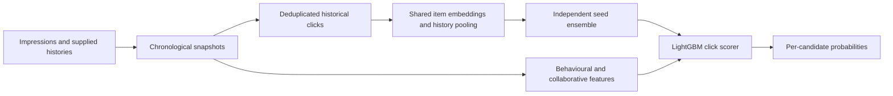

# MCMF · Click Prediction for Huawei TechArena 2026

An experimental recommendation pipeline that predicts clicks from anonymous user–item interactions. The project covers parsing millions of impressions, reconstructing historical clicks, learning item representations, training boosted trees, and evaluating experiments on chronological windows.

**Recorded official ROC AUC: 0.816323.** Later research reached **0.824787 on local confirmation**, a **+0.002280** improvement over the same baseline on matched rows. The later result is a local experiment, not an official score.

For a quick review: [experiment progression](docs/PROGRESS.md) · [results and lessons](docs/experiments/research-summary.md) · [model implementation](src/history_upgrade.py) · [evaluation harness](research/evaluate.py) · [tests](tests/)

## The problem

Each recommendation event presents **10 candidate items** to one user. At most one is clicked; some events receive no click. Given opaque IDs, timestamps, event context, and up to 20 recent clicks, predict a probability for every candidate. The metric is **global row-level ROC AUC**, so comparisons across events matter as well as ranking candidates within an event.

- **Training:** 6,868,240 candidate rows across 686,824 events.
- **Evaluation:** 529,390 rows, one first event per user after the cutoff.
- **Data:** synthetic interactions; no item descriptions or user demographics.

See the [task specification](INSTRUCTIONS.md) for the full contract.

## Approach



The strongest representation uses one shared item embedding table: the user's mean clicked-item vector is compared with each candidate. Scalar user and item biases capture click propensity. An auxiliary sampled classification loss learns from historical clicks, including warm-up clicks absent from the labelled impression rows. Histories are reconstructed up to 100 clicks while excluding current and future clicks from prediction inputs.

Independent models run together as a vectorized seed ensemble. Their **score components**, rather than embedding coordinates, are averaged and combined with behavioural and event-relative features in LightGBM. Training uses PyTorch on Apple MPS or CPU; a separate tree worker avoids the macOS OpenMP conflict between PyTorch and LightGBM.

The repository retains earlier factorization and CatBoost pipelines, DIN/DeepFM/DCNv2 benchmarks, feature ablations, and unsuccessful experiments.

## Results

| Approach | Local Jan 26 ROC AUC | Official ROC AUC | Evidence |
|---|---:|---:|---|
| Starter solution | 0.6141 | — | [Source](src/starter_solution.py) |
| User/history factorization | 0.7062 | — | [Report](docs/experiments/strategy1.md) |
| DIN / DeepFM / DCNv2 | 0.6727 / 0.7120 / 0.7204 | — | [Benchmark](docs/experiments/ctr-benchmark.md) |
| Behavioural CatBoost | 0.7268 | — | [Report](docs/experiments/strategy2.md) |
| Shared-item history ensemble + LightGBM | 0.822508 | **0.816323** | [Score record](results/official_scores.json) |
| Research: 30 seeds, shorter fitting, smaller initialization | 0.824512 | — | [Evaluator snapshot](docs/experiments/research-leaderboard.md) |
| Research: fitting-period tree selection and refit | 0.824669 | — | [Evaluator snapshot](docs/experiments/research-leaderboard.md) |
| Research: equal-weight logit blend | **0.824787** | — | [Research summary](docs/experiments/research-summary.md) |

The official result was reported by the team and linked to a locally verified submission SHA-256; it was not independently checked against a competition receipt. No later official score is recorded. Local and official AUC use different populations and must not be treated as interchangeable.

### Evaluation discipline

- Models and label-based statistics are fitted before each scoring cutoff. All ten candidates in an event stay together.
- **Development:** each user's first event during Jan 24–25, 2025; used for model search. **Confirmation:** each user's first event on Jan 26.
- The evaluator checks exact row alignment and finite predictions, reports slices, and uses event-level paired bootstrap intervals for baseline deltas.
- Development runs can early-stop on development labels, so those scores are optimistic. The optional tree-refit policy selects iterations within the fitting period instead.
- Confirmation has been reused, including in earlier development. It is a sanity check, not an untouched test set. Bootstrap intervals exclude model selection and temporal uncertainty.

The [research report](docs/experiments/research-summary.md) explains diminishing returns from more seeds, corrected ablation bugs, and weak performance for sparse or stale histories.

## Run locally

**Python 3.12** and the pinned files under `requirements/` are the recorded environment. The core pipeline supports CPU and Apple MPS; CUDA is not exposed by this pipeline's device selector.

```sh
uv venv --python 3.12 .venv
uv pip install --python .venv/bin/python -r requirements/history-upgrade.txt

# Synthetic unit tests: no competition data or trained models required.
.venv/bin/python -m unittest discover -s tests -t . -v
```

The tests cover temporal boundaries, target masking, unknown users, empty histories, seed independence, checkpoint resume, feature-cache identities, tree refitting, prediction alignment, and evaluator promotion rules.

### Data and preprocessing

Obtain the competition data from the organizers and place `train.csv` and `evaluation.csv` in the repository root. The supplied `example_submission.csv` is useful for checking the output format. Training is about 7.3 GB; the full local experiment collection needs substantially more disk space than this source repository.

```sh
# Parse CSV/JSON histories into memory-mapped arrays.
.venv/bin/python analysis/profile_data.py

# Build behavioural features required by the history pipeline.
OPENBLAS_NUM_THREADS=2 .venv/bin/python src/strategy2.py prepare --device auto
```

### Reproduce a single pipeline

Use a fresh output directory for every changed recipe. These commands train models; the unit tests above do not.

```sh
# Original ten-seed recipe, restricted to the recorded LightGBM learner.
OPENBLAS_NUM_THREADS=2 .venv/bin/python src/history_upgrade.py \
  --device auto --output-dir runs/baseline-reproduction \
  --seeds 10 --steps 5000 --init-std 0.05 \
  --tree-candidates LightGBM:31 --until final

# Later 30-seed recipe with fitting-period tree selection.
OPENBLAS_NUM_THREADS=2 .venv/bin/python src/history_upgrade.py \
  --device auto --output-dir runs/research-refit-reproduction \
  --seeds 30 --steps 3000 --init-std 0.005 \
  --tree-refit-policy --tree-candidates LightGBM:31 --until final
```

The original full pipeline took approximately 25 minutes on an Apple M5 Pro in the recorded run; larger ensembles take longer. Hardware and dependency differences can change results. The final stage writes logits, submission CSVs, models, and reports under the chosen run directory.

The best local result blends four runs. Component IDs, commands, seed selection, and available recipes are preserved in [`configs/experiments/`](configs/experiments/). These JSON files are provenance manifests, not a separate configuration loader. Read the [reproduction limits](docs/experiments/research-summary.md#reproducibility) before attempting an exact replay. The optional [research harness](research/README.md) documents the evaluator and original machine-specific automation.

For a dependency-free starting point:

```sh
python3 src/starter_solution.py \
  --train train.csv --evaluation evaluation.csv --out submission.csv
```

## Repository guide

| Path | Contents |
|---|---|
| `src/` | Training, feature engineering, tree workers, and submission writer |
| `research/` | Experiment launcher, evaluator, preflight checks, and research tooling |
| `tests/` | Synthetic unit tests for models and experiment infrastructure |
| `configs/experiments/` | Small saved run manifests and recipes |
| `analysis/` | Data profiling code and aggregate audits |
| `docs/experiments/` | Experiment reports, research summary, and archived leaderboard |
| `results/` | Append-only official score provenance |
| `requirements/` | Pinned dependencies for each pipeline |

Datasets, model weights, feature arrays, predictions, run directories, environments, credentials, and cloned reference repositories stay outside Git. A fresh clone contains the source and evidence, not pretrained inference artifacts. This repository is a research project, not a deployed service.

## References and development provenance

The historical-click representation and auxiliary-training approach were informed by the public [ATU TechArena solution](https://github.com/jancastachova/techarena2026-atu). The [reference study](docs/REFERENCE_SOLUTION_STUDY.md) records the inspected commit, methodological differences, and attribution. Earlier CTR benchmarks use [FuxiCTR](https://github.com/reczoo/FuxiCTR). A later [public repository survey](docs/PUBLIC_TEAM_REPO_SEARCH.md) records additional hypotheses; finding an approach there does not mean it was implemented here.

This team project used AI coding assistants for implementation, experiment automation, analysis, and documentation. The retained research tooling and notebooks document that workflow, including corrections to earlier claims. Results here are tied to recorded evaluations rather than generated estimates.
